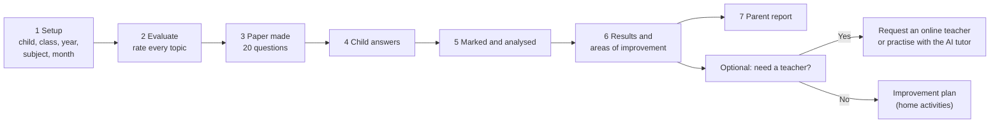
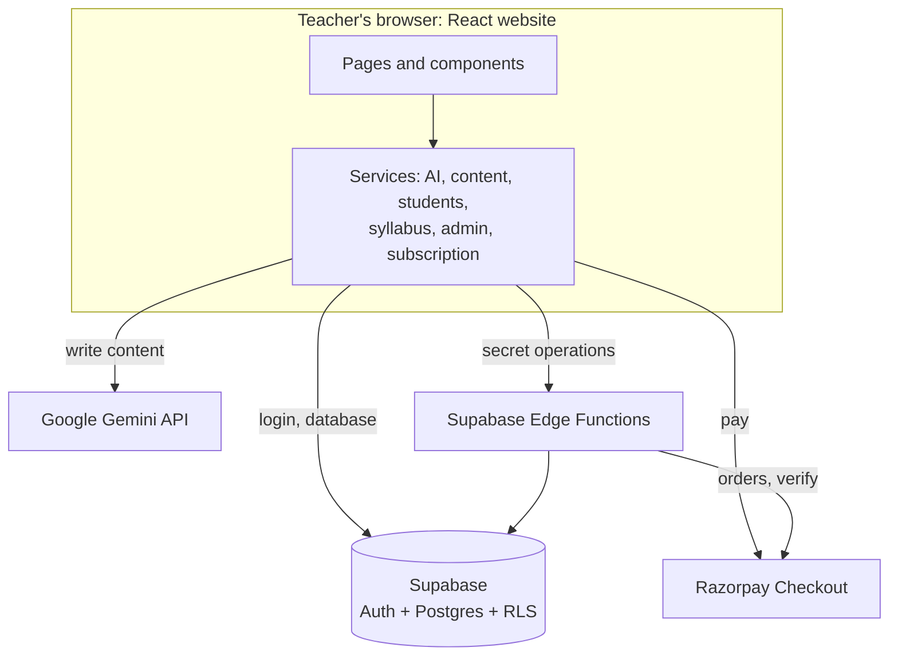
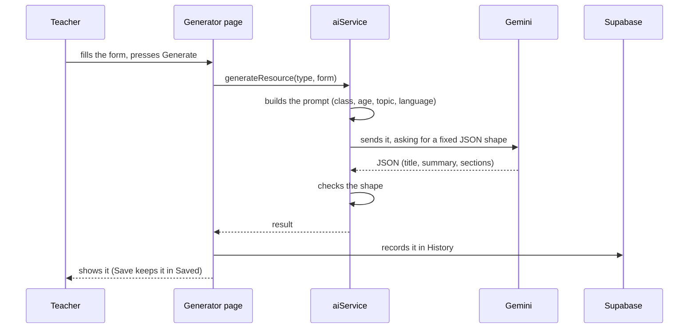
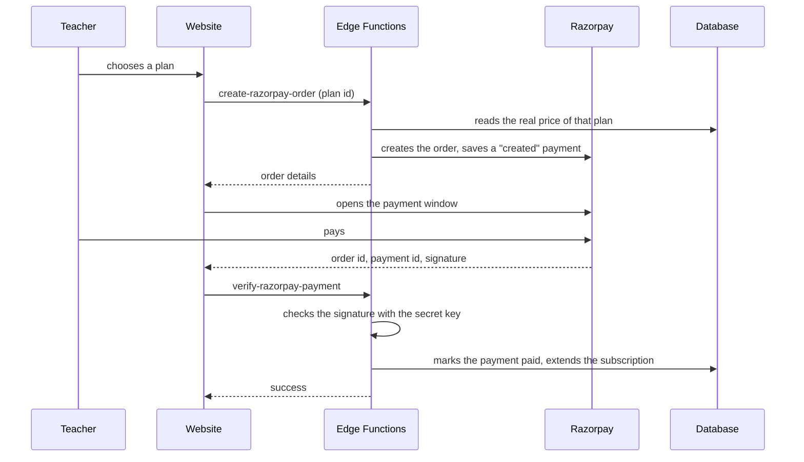
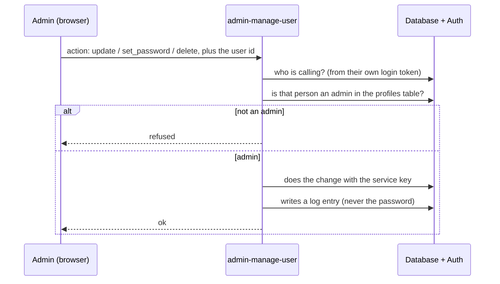

# Adiuvaret AI Classroom Generator — Project Documentation

**Describes the app as it is on 27 October 2026.** It replaces the older "Feature Guide", which was written
when everything was stored inside the browser and many of today's features did not exist.

**Live site:** https://ai-classroom-generator.adiuvaretfoundation.com

> **Viewing this file.** The diagrams use Mermaid. They show as pictures in GitHub, in VS Code with the
> "Markdown Preview Mermaid Support" extension, and in most Markdown viewers. If you only see code blocks,
> the text around each diagram still explains it.

---

## Contents

**Part 1 — Overview**
1. [What the product is](#1-what-the-product-is)
2. [Who uses it, and what each person can do](#2-who-uses-it-and-what-each-person-can-do)

**Part 2 — Using the app**
3. [The screen layout](#3-the-screen-layout)
4. [Signing up, logging in, signing out](#4-signing-up-logging-in-signing-out)
5. [The Dashboard](#5-the-dashboard)
6. [The five resource generators](#6-the-five-resource-generators)
7. [History and Saved Content](#7-history-and-saved-content)
8. [Syllabus](#8-syllabus)
9. [Child Assessment](#9-child-assessment)
10. [Students & Reports](#10-students--reports)
11. [Subscription and payments](#11-subscription-and-payments)
12. [Profile, Password Management and Settings](#12-profile-password-management-and-settings)
13. [The Admin Dashboard](#13-the-admin-dashboard)

**Part 3 — How it works inside**
14. [Architecture](#14-architecture)
15. [The database](#15-the-database)
16. [Security](#16-security)
17. [The AI (Gemini)](#17-the-ai-gemini)
18. [Business rules in one place](#18-business-rules-in-one-place)

**Part 4 — Running it**
19. [First-time setup, step by step](#19-first-time-setup-step-by-step)
20. [Deploying a new version](#20-deploying-a-new-version)
21. [Everyday admin tasks](#21-everyday-admin-tasks)
22. [Troubleshooting](#22-troubleshooting)

**Part 5 — Quality and future**
23. [Testing and quality](#23-testing-and-quality)
24. [Known gaps and suggestions](#24-known-gaps-and-suggestions)

**Appendices**
[A. Every page](#appendix-a--every-page) · [B. Settings and keys](#appendix-b--settings-and-keys) ·
[C. Server functions](#appendix-c--server-functions-edge-functions) · [D. Activity log](#appendix-d--the-activity-log) ·
[E. Code map](#appendix-e--code-map) · [F. Glossary](#appendix-f--glossary)

---

# Part 1 — Overview

## 1. What the product is

Adiuvaret AI Classroom Generator is a website for teachers of **pre-primary to Class 3** (PG, Nursery, LKG,
UKG, Class 1, Class 2, Class 3). It does two main jobs.

**Job 1 — Make teaching material with AI.** A teacher chooses a class, subject and topic. The AI writes a
**worksheet**, **lesson plan**, **quiz**, **classroom activities** or **exam paper**. Everything is written for
the age of the children (for example, picture-based tasks that an adult reads aloud for 3-year-olds).

**Job 2 — Check a child's progress.** The teacher picks a class, subject and month. The app takes that month's
**syllabus**, asks the teacher to rate each topic, then creates a **20-question paper**. After the child answers,
the app marks it, shows a **level** and the **areas of improvement**, and prints a **parent report**.

Around these two jobs are accounts, a paid **subscription** (Razorpay), and an **Admin Dashboard** for the
Adiuvaret team.

### Key facts

| Item | Detail |
|---|---|
| Classes | PG, Nursery, LKG, UKG, Class 1, Class 2, Class 3. Nothing above Class 3 can be chosen. |
| Subjects | English, Math, EVS for PG to Class 2. English, Math, Science for Class 3. |
| Languages | Resources can be written in **English** or **Hindi** (Dashboard → Customize Experience). Child assessments are always English. |
| School year | April to March, in four terms: Term 1 Apr–Jun, Term 2 Jul–Sep, Term 3 Oct–Dec, Term 4 Jan–Mar. |
| Website | A React single-page app, built to plain files and hosted on ordinary Apache/cPanel hosting. |
| Back end | **Supabase** (accounts, database, small server functions). There is no server of our own. |
| AI | **Google Gemini**, called from the browser. |
| Payments | **Razorpay**. |
| Themes | Light and dark. |

---

## 2. Who uses it, and what each person can do

| Person | Logs in? | What they can do |
|---|---|---|
| **Visitor** (not signed in) | No | See the login and sign-up pages only. Every other address sends them to the login page. |
| **Teacher** (role `user`) | Yes | Open the Dashboard, Profile, Password Management, Settings and Subscription. With an **active subscription**: all generators, Child Assessment, Syllabus, Students & Reports, History and Saved Content. |
| **Admin** (role `admin`) | Yes | Everything a subscribed teacher can do **without needing a subscription**, plus the Admin Dashboard. |
| **Parent** | No | Never logs in. A parent receives the printed or PDF **Progress Report** from the teacher. |

A child is only a **row in a teacher's list** (name + class). Children have no login.

### Which pages need what

| Page | Needs login | Needs subscription | Admin only |
|---|:---:|:---:|:---:|
| Login `/`, Sign up `/signup` | — | — | — |
| Dashboard `/dashboard` | ✔ | — | — |
| Profile `/profile`, Password Management `/password`, Settings `/settings`, Subscription `/subscription` | ✔ | — | — |
| Worksheet `/worksheet`, Lesson `/lesson`, Quiz `/quiz`, Activities `/activities`, Exam `/exam` | ✔ | ✔ | — |
| Child Assessment `/assessment`, Syllabus `/syllabus`, Students `/students` | ✔ | ✔ | — |
| Saved Content `/saved`, History `/history` | ✔ | ✔ | — |
| Admin Dashboard `/admin` | ✔ | — | ✔ |

Without a subscription, the paid pages send the teacher to the Subscription page. A "buy a subscription"
pop-up also comes back 10 seconds after each time it is closed (except on the Subscription page itself, so it
never covers the pay buttons).

---

# Part 2 — Using the app

## 3. The screen layout

Every signed-in page has the same frame.

- **Sidebar (left, dark blue):** Dashboard · Admin Dashboard (admins only) · Worksheet Generator · Lesson Plan
  Generator · Quiz Generator · Activity Generator · Exam Paper Generator · Child Assessment · Syllabus ·
  Students & Reports · Saved Content · History · Subscription · Profile · **Password Management** · Settings ·
  Logout.
- **Top bar:** the page title, a **search box** (searches your own generated resources by title, class, subject or
  type and opens a preview), an "AI ready" label, a bell (no function yet), a light/dark button and your name
  (click for a small profile card).
- **Main area:** the page itself.

**Scrolling.** The sidebar always stays where it is. Only the main area scrolls. On a short window the sidebar
scrolls by itself so **Logout** is always reachable. On a phone the sidebar hides; the menu button opens it.

---

## 4. Signing up, logging in, signing out

**Sign up (`/signup`).** Name, email, password (at least 6 characters) and confirmation. If the project requires
email confirmation, the person gets an email and the link signs them in on the live site.

**Log in (`/`).** Email and password. **Admins go straight to the Admin Dashboard; everyone else goes to the
Dashboard.** The session is kept, so a refresh does not log the person out.

**Not working yet (on the login page):** "Continue with Google" (a placeholder message), "Remember Me" (the
session is always kept) and "Forgot Password?" (a dead link). To help someone who forgot their password, an
admin uses **Admin Dashboard → Edit → Send reset link** (see [section 13](#13-the-admin-dashboard)).

**Sign out.** Sidebar → Logout.

---

## 5. The Dashboard

The first screen after login has four parts.

1. **"Is my child's knowledge as expected?"** — choose **academic year, class, subject and month** (or a whole
   term), then press the button. It opens Child Assessment with those choices already filled in.
2. **Seven cards** that open the assessment side of the app: Annual Syllabus, Monthly Syllabus, Student Details,
   Assessment, Results, Areas of Improvement, Progress Report.
3. **Teaching tools** — cards for the Worksheet, Lesson Plan, Quiz and Activity generators.
4. **Customize Experience** — choose the **language** the AI writes resources in (English or Hindi). This is saved
   on the device, and it applies to every generator except Child Assessment.

The three numbers shown (for example "240+ Resources generated") are fixed text, not live statistics.

---

## 6. The five resource generators

All five work the same way:

1. Choose **Class**. The **Subject** list then shows only the subjects for that class.
2. Fill in the topic and the other fields, then press the Generate button.
3. Wait a few seconds. The result appears on the right. Every text result is added to **History**; press **Save**
   to also keep it in **Saved Content**. (Worksheet *images* are not kept: download them.)
4. If the AI is busy, a clear message appears with a **Try again** button.

**Pitched at the right age.** The AI is always told the children's age and how they read. For PG–UKG it writes
spoken, picture and action based tasks. A topic that is too advanced (for example "Photosynthesis" for PG) is
simplified, never refused.

**Colours.** Each result card has its own colour. The subject chooses the colour family, the class chooses the
shade, and the type of resource shifts it slightly. This only helps the eye; it has no other meaning.

| Generator | You fill in | You get |
|---|---|---|
| **Worksheet** `/worksheet` | Class, Subject, Topic, Difficulty (Easy / Medium / Hard), Worksheet type (free text, default "Practice"), Learning objectives, Additional instructions | **Image mode (default):** a finished printable A4 page drawn by the AI, which you **download** (PNG/JPG). **Text worksheet:** sections *Warm-Up*, *Practice*, *Reflection*. |
| **Lesson Plan** `/lesson` | Class, Subject, Topic, Duration (default 45 mins), Learning objective | Sections *Opening*, *Guided Practice*, *Independent Practice*, *Closing* |
| **Quiz** `/quiz` | Class, Subject, Topic, Duration, Learning objective | 8–10 multiple-choice questions you can **play on screen** (see below) |
| **Activity Ideas** `/activities` | Class, Subject, Topic, Duration (default 30 mins), Objective | 3–4 activities, each with a setup and a learning outcome |
| **Exam Paper** `/exam` | Class, Subject, Topic, Duration, Total marks, Difficulty, Instructions | The **student paper** (Section A: 5 short questions, Section B: 5 application questions) and, separately, a **teacher answer key** |

> **Worksheet images need billing.** Gemini image models are not free. Image mode works only when the Google
> project behind the API key has billing switched on; otherwise it shows a "quota" message. **Text worksheet** is
> unaffected. Images are **not saved** (they are too large): download them straight away.

### The quiz player and "second round"

After **Start Quiz**, the student answers one question at a time. At the end they see:

- a **score ring** with the percentage and a **level**;
- a message written to the student, for example *"You scored 20%. You need to work on this part…"*;
- **"Work on this part"** — every wrong question, with the student's answer marked *your answer*, the *correct
  answer*, and a one-line *Why* from the AI;
- a collapsed list of the questions they got right;
- a **"Practise the N missed questions"** button.

That button starts **round 2 with only the missed questions** (options are shuffled again, so the student cannot
just remember "it was C"). The student repeats until every question is right. A trail shows each round
(for example *Round 1: 2/10 → Round 2: 5/8*) and how many questions are now right in total.
**Retake whole quiz** and **Back to overview** are always available. Rounds live only on the screen; they are not
saved.

### The exam paper and its answer key

The paper shown to students holds **only questions and their options**. The answers are never part of it. They
are in a collapsed box under the paper called **Teacher answer key (teacher only, not part of the student
paper)**. The same box appears in the History and Saved previews. Papers saved earlier, which had an "Answer
Guide" inside, were converted automatically: that section now sits in the teacher answer key. There is no PDF
export for exam papers.

---

## 7. History and Saved Content

- **History** (`/history`) is the log of everything you generated, newest first. You can filter by type
  (Worksheet, Lesson Plan, Quiz, Activity, Exam Paper), search, **view** a preview, **save**, or **delete** one item.
  *Clear history* removes every item you have **not** saved; saved items stay. (The page text says "last 50", but up to **200** are loaded — see
  [section 24](#24-known-gaps-and-suggestions).)
- **Saved Content** (`/saved`) is your library: the items you pressed **Save** on. **Remove** takes an item out of
  Saved. A saved item is the **same row** as its History entry, so **deleting one item from History also removes
  it from Saved** (only *Clear history* spares saved items).
- Your history belongs to you. Nobody else sees it, except admins (read only).
- Worksheet **images** are never stored.

---

## 8. Syllabus

The **Syllabus** page (`/syllabus`) holds the topics ("learning outcomes") taught in each month. The child
assessment is built **only** from these topics.

- **Structure:** one list of topics for each **academic year + class + subject + month**. Terms are shown for
  convenience (Term 1 = April–June, and so on).
- **Two tabs:** **Annual** (the whole year, term by term) and **Monthly** (one month in detail).
- **Whose syllabus?** A teacher's **own** list for a month always wins over the **School syllabus**. An **admin**
  can save a month as the **School syllabus**, and then every teacher sees it.
- **Typing topics:** one topic per line. Up to 15 topics per month, 160 characters each. Bullets and numbers are
  removed automatically.
- **AI help:** "Suggest with AI" and "Draft empty months with AI" only **fill the editor with a draft**. Nothing is
  saved until you press save, so you can read and correct it first.
- **Nobody is blocked:** if a chosen month has no syllabus when starting an assessment, the editor appears right
  there.

### Ready-made syllabus: Class 2 Maths

`supabase/seed-class2-math-syllabus.sql` loads the NCERT *Joyful Mathematics* Class 2 book (14 chapters) as the
School syllabus for 2024-25 to 2028-29. Each chapter is split into its learning outcomes (28 in total).
Because the book has no month plan, chapters follow the book's own order: one chapter a month from April, two in
January and two in February, and chapter 14 in March. Any month can be edited afterwards. See
[section 19](#19-first-time-setup-step-by-step) for how to run it.

---

## 9. Child Assessment

Opened from the Dashboard question, the sidebar, or the Assessment card. It works as a sequence of steps.



**1. Setup.** Choose the child (or add one), the class, academic year, subject, and either a **month** or a whole
**term** (an end-term paper). The syllabus for that period loads automatically.

**2. Evaluate.** The teacher rates **every topic** from what they have seen in class:
🌟 **Excellent**, 😊 **Good**, 🙂 **Average**, 🌱 **Needs Improvement**. The button to continue stays off until
all topics are rated. These ratings shape the paper (extra questions on weak topics) and appear beside the
child's results. *Nothing fills a rating in for you.* A rating shown later as "Teacher's rating: …" is exactly
what was chosen on this step.

**3. The paper.** The AI writes **20 questions** using only the syllabus topics. The mix depends on age:

| Children | Question mix (of 20) |
|---|---|
| **PG to Class 2** — an adult reads each question aloud | 4 picture questions · 6 multiple choice · 4 fill-in (tap to choose) · 3 match · 3 simple activities |
| **Class 3** | 12 multiple choice · 3 fill-in · 2 true/false · 2 match · 1 problem solving |

Pictures are emoji. The answer options are shuffled by the app so the right answer is not always first.

**4. The child answers**, one question at a time. Activity questions are done by the child with the adult
watching; the adult marks "did it on their own" or "needed help".

**5. Marking.** The app marks every answer itself against the answer key. This part never uses AI. The AI is used
only for (a) a second opinion on **typed** answers that missed the key, (b) the diagnosis text, home activities and
recommendations, and (c) a first draft of the teacher's remarks. If the AI fails, the teacher still gets the score
and the topics to practise.

**6. Results.** Score, **level**, a score for each of seven **development areas**, a bar for each topic,
**strengths**, **areas of improvement** (grouped by area, each with a diagnosis and "Try at home" ideas), and AI
recommendations.

**7. Parent report.** A one-page, parent-friendly sheet: name, class, subject, month, score, level, strengths,
areas of improvement, topics to practise, and the **teacher's remarks** (editable box). **Download / Print
report** opens the browser's print window; choose "Save as PDF" to make a file.

Also available: **PDF of the paper and answers** — the child's paper (questions only) followed by the teacher's
answer and performance report.

**Online teacher / AI tutor.** After results the teacher is asked *"Do you need an online teacher?"*
- **Yes** → a request (topics to cover, preferred time, contact, note). Admins see it and move it through
  *Requested → Teacher assigned → Completed*. There is also an optional **"Practise with AI"** chat tutor for one
  weak topic, followed by a 10-question retest.
- **No** → an **Improvement plan** of activities (the AI is told not to invent websites or book titles).

### The seven development areas

Language & Communication · Literacy · Numeracy · Cognitive Skills · Social & Emotional Skills · Environmental
Awareness · Movement & Physical Development. Every question carries one of these.

### Levels (used everywhere)

| Score | Level |
|---|---|
| 90% and above | **Excellent** |
| 75% – 89% | **Good** |
| 60% – 74% | **Average** |
| Below 60% | **Needs Improvement** |

The level is always worked out from the percentage, never read from a saved label.

### Which topics are "areas of improvement"?

A topic is listed when **either** the child scored **under 75%** on it **or** the teacher rated it **Needs
Improvement**. This is why a topic the teacher rated *Excellent* can still appear: the child's answers on that
topic were weak. The page shows both: *"Teacher's rating: Excellent"* and *"1/4 correct"*.

### Privacy

A **child's name is never sent to the AI.** The AI sees only class, subject, syllabus topics and the answers.

---

## 10. Students & Reports

`/students` has four tabs (the dashboard cards open them directly):

| Tab | Shows |
|---|---|
| **Student details** | The class list. Add a child, **edit** their name or class, **delete** them (this also deletes their assessments). Summary numbers: current score, improvement since the last paper, topics mastered, topics needing improvement. |
| **Results** | Every assessment with date, score and level; a **score trend** chart; **PDF** download for each. |
| **Areas of improvement** | The latest paper's weak topics grouped by development area, plus topics "still to practise" from earlier papers. |
| **Progress report** | The printable parent report for the chosen paper. |

Each person sees only **their own** children, admins included. (The database lets an admin *read* every
teacher's children for support, but only the child's own teacher can change or delete them, so the page does not
list them: they could not be edited, deleted or assessed from another account.)

---

## 11. Subscription and payments

- **Plans** are set in the database. The shipped examples are **1 Month ₹499, 3 Months ₹1,299, 6 Months ₹2,399,
  1 Year ₹4,299**. Change them in `supabase/schema.sql` before the first run, or later with SQL
  (see [section 21](#21-everyday-admin-tasks)). Every plan includes all generators.
- **Paying.** On the Subscription page choose a plan. Razorpay's payment window opens. After payment the app asks
  the server to verify it; only then is the subscription extended.
- **Renewing early never loses days.** The new end date is *the later of today and the current end date*, plus the
  plan length.
- **Status** is one of **Active, Paused, Expired, Cancelled, None**. A subscription counts as active only when its
  status is *active* **and** the end date is in the future.
- **Paused** (done by an admin): the stop date is recorded. When resumed, the paused time is added back to the end
  date, so a pause never costs the teacher any days.
- **Payment history** (the last 20 payments) is shown on the page.
- **Admins** are never blocked by the paywall.

---

## 12. Profile, Password Management and Settings

### Profile (`/profile`)
Shows the display name, email and role. The **display name** can be changed. A card links to Password Management.

### Password Management (`/password`)
The only place where a person changes their own password.

- Enter the **current password**, then the **new password twice**. A live checklist shows the rules: at least 6
  characters, different from the current one, both new entries match.
- The current password is checked first (by signing in again). Wrong current password → "Your current password is
  not correct" and nothing changes.
- The eye button shows or hides the fields. Fields are emptied after saving. The password is **never stored or
  shown** by the app; only the fact that it changed is recorded in the activity log.
- **Arriving from a reset-link email:** the person is signed in and sent to this page automatically. They are not
  asked for the old password (they do not know it). After saving, normal rules apply again.
- A second card explains *Forgot your password?* to teachers, and *Resetting someone else's password* to admins.

### Settings (`/settings`)
Only **Dark mode** does something (it is saved on the device). *Compact layout*, *Weekly digest* and *Smart
suggestions* are switches with no effect yet.

---

## 13. The Admin Dashboard

`/admin` — admins only. It opens automatically after an admin logs in.

### Numbers
Total users · Active subscriptions · Resources generated · Revenue this month.

### Users table
Search by name, email or role. Columns: Name, Email, Role, Plan, Status, Expires, Joined. Each row has two
buttons: **Edit** and **Delete**.

**Edit** opens one simple window, like this:

| Field | What it does |
|---|---|
| **Username (email)** | The login email. Changing it asks for confirmation. The person must use the new email from then on. |
| **Name** | Display name. |
| **Password** | Type or **Generate** a **new** password; leave empty to keep the current one. The eye shows what you type. **Copy** copies it. **Send reset link** emails the person a link so they choose their own. A line shows when the password was last changed and how. |
| **Account type** | User or Admin. Locked on your own row. |
| **Plan (price)** | Choose a plan. |
| **Subscription end date** | The date the access ends. Choosing a new plan adds its length on top of any time left. |

Press **Update**. Only what changed is sent. If one part fails (for example, the email already belongs to someone),
the window stays open, says which part failed, and keeps the parts that saved. When a **new password** is saved,
the window stays open and shows it **once** in a green box with a **Copy** button, so you can give it to the
person. When the window is closed, the password is gone from the screen and from the browser.

A small link at the bottom ("Pause or cancel the subscription, or see activity") opens the **Manage** window:
subscription controls (give or update a plan, **Pause**, **Resume**, **Cancel**, **Delete subscription**), the
user's recent activity and what they generated.

**Delete** removes the whole account after a clear confirmation. It deletes their subscription, payments, saved
content, students and assessments, and **cannot be undone**. You cannot delete your own account, and the last
admin cannot be deleted or demoted.

**You can never see a person's current password.** See [section 16](#16-security) for why.

### Online teacher requests table
Every request from teachers: when, student, class and subject, topics, who asked, preferred time and contact, and
status. Admins change the status: Requested → Teacher assigned → Completed. (Teachers can only create and read
their own requests.)

---

# Part 3 — How it works inside

## 14. Architecture

There is **no server of our own**. The website runs in the browser and talks to three outside services.



### Technology

| Layer | Choice |
|---|---|
| Website | React 19, Vite 8, react-router-dom 7, Tailwind CSS 4 (plus a large hand-written `index.css`) |
| Icons | lucide-react, react-icons |
| PDF | jsPDF (loaded only when a PDF is made) |
| Accounts and data | Supabase: Auth, Postgres with Row Level Security, Edge Functions (Deno) |
| AI | Google Gemini REST API (no SDK) |
| Payments | Razorpay Checkout + Edge Functions |
| Code checking | Oxlint |
| Hosting | Any static host. Today: Apache on cPanel, with an `.htaccess` for page addresses |

### How the website is organised

- **Pages** (`src/Pages`) — one file per screen.
- **Components** (`src/Components`) — shared pieces: sidebar, top bar, route guards, plus `assessment/` and
  `admin/` groups.
- **Services** (`src/Services`) — all the logic that is not drawing. The database and the AI are only touched from
  here.
- **Context** (`src/context`) — `AuthProvider` (who is signed in, their role) and `SubscriptionProvider`
  (whether they may use paid pages).
- **Stores** — `contentStore` keeps your History and Saved items in memory (loaded from the database at login) so
  search is instant; `sidebarStore` holds whether the phone menu is open.
- **On the device only:** light/dark theme and the AI language (`localStorage`).

### Generating a resource



### Paying



### Editing another user (admin)



---

## 15. The database

All tables are in Supabase Postgres and are created by `supabase/schema.sql`. **Row Level Security** is switched
on for every table: a person can only read and change their own rows unless a rule below says otherwise.

| Table | What it holds | Who can see it |
|---|---|---|
| `profiles` | One per login: `email`, `full_name`, `role` (`user` / `admin`) | Own row; admins see all |
| `plans` | `code`, `name`, `duration_months`, `price_inr`, `is_active` | Every signed-in user (read only) |
| `subscriptions` | One per user: `plan_id`, `status`, `start_date`, `end_date`, `paused_at` | Own; admins can change |
| `payments` | Razorpay order and payment ids, amount, `status` (`created` / `paid` / `failed`) | Own; **only the server writes** |
| `activity_log` | `action`, `metadata` for each user | Own; admins see all |
| `generated_content` | History and Saved in one row: `type`, `title`, `summary`, `note`, `sections`, `questions` (quiz), **`answer_key`** (exam), `class_name`, `subject`, `is_saved`, `saved_at` | Own; admins can read |
| `students` | `teacher_id`, `name`, `class_name` | The teacher; admins can read |
| `assessments` | One finished paper: `kind` (`current` / `end_term` / `practice`), class, subject, `academic_year`, `month`, questions with answer key, answers, per-question results, `total`, `correct`, `percentage`, `weak_areas`, `skill_results`, `recommendations`, `improvement_plan`, `skill_ratings`, `teacher_remarks`, `summary` | The teacher; admins can read |
| `student_topics` | Per child, subject and skill: `status` (`mastered` / `needs_practice`), `last_score`, `attempts` | The teacher |
| `teaching_sessions` | AI tutor chats: `skill`, `transcript`, practice score | The teacher |
| `teacher_requests` | Online-teacher requests: areas, `preferred_time`, `contact`, `note`, `status` (`requested` / `assigned` / `completed` / `cancelled`) | The teacher can create/read; **only admins change status** |
| `syllabus_entries` | `academic_year`, `class_name`, `subject`, `month`, `topics` (a list), `owner_id`, `is_shared` | Everyone can read **shared** rows and their own; only admins write shared rows |

**Automatic things in the database**

- `handle_new_user` — when someone signs up, a `profiles` row is created.
- `is_admin()` — a safe check ("is the caller an admin?") used by many rules.
- `prevent_role_self_escalation` — stops a signed-in person from changing their own role or login email through
  the browser. (The server function and the SQL editor can.)
- Deleting a login **cascades**: the profile, subscription, payments, content, students, assessments and
  everything else linked to that person are deleted with it.

**Rules worth knowing**

- At most **one shared syllabus row per month**, and one personal row per teacher per month.
- A student's id on any child record must belong to the signed-in teacher, so a guessed id cannot attach data to
  someone else's child.
- Status of a subscription is not updated by a timer. "Expired" is **worked out** from the end date whenever it is
  shown.

---

## 16. Security

| Topic | How it is handled |
|---|---|
| **Who may see what** | Row Level Security in Postgres. Even if someone changed the website code in their own browser, the database still refuses other people's rows. |
| **Admin checks** | Done inside the database (`is_admin()`) and inside every server function by reading the caller's role from `profiles`. The browser's claim to be an admin is never trusted. |
| **Becoming admin** | Only through SQL or an existing admin. A signed-in user cannot change their own role. |
| **Payments** | The price is read on the server, not sent by the browser. The Razorpay signature is checked with the secret key before any subscription is extended. Only server functions can write `payments`. |
| **Secret keys** | The Razorpay **Key Secret** and the Supabase **service-role key** exist only as Edge Function secrets. Anything starting with `VITE_` is inside the website and visible to anyone. |
| **Passwords** | Supabase keeps only a **one-way hash**. The app never stores, logs or shows a password. **Nobody, including admins and developers, can read someone's current password.** Admins can set a new one (sent once to the server function, shown once on screen, never stored) or email a reset link. A readable copy of passwords was deliberately **not** built: a database leak would expose every teacher's login, and many people reuse passwords. |
| **Children's privacy** | Names are never sent to the AI. |
| **Reset links** | Open `/password`, which must be in the Supabase "Redirect URLs" list. |
| **Known exposure** | The Gemini key is inside the website, so anyone can extract it and use your quota. Restrict it to your domain, put a spending cap on it, or move Gemini calls into an Edge Function. |
| **Optional hardening** | Turn on **Authentication → Providers → Email → Secure password change** in Supabase to make the server also require a recent login for password changes (the app's "current password" check is only in the browser). |

---

## 17. The AI (Gemini)

**Models.** Text uses `gemini-flash-latest` (change with `VITE_GEMINI_MODEL`). Worksheet images use
`gemini-3.1-flash-image` (`VITE_GEMINI_IMAGE_MODEL`).

**Always JSON.** Every text request asks for a fixed JSON shape and the app checks it. A wrong shape is treated as
an error and the teacher can retry.

**Automatic fall-back.** If the main model does not answer in time (20 s for small jobs, 40 s for big ones), is
offline, is overloaded (5xx), has been retired (404) or is over quota (429), the app tries
`gemini-flash-lite-latest`. A model that failed is tried **last for 10 minutes**, so only the first request pays
the wait. A wrong key, a blocked prompt or a broken reply does **not** switch models, because they would fail
everywhere. Image generation does not fall back.

**What the AI writes, and what it does not**

| Task | AI? |
|---|---|
| Worksheets, lessons, quizzes (with a one-line reason for each answer), activities, exam paper **and** its separate answer key | Yes |
| Syllabus drafts ("Suggest with AI") | Yes, as an unsaved draft |
| The 20-question assessment paper | Yes |
| **Marking an assessment** | **No** — done by the app against the answer key |
| Second opinion on typed answers; diagnosis; recommendations; improvement plan; remarks draft; AI tutor | Yes |
| Child names | **Never sent** |

**Prompts** are built in `src/Services/promptBuilder.js` (resources) and `src/Services/assessmentPrompts.js`
(assessments and tutor). Every resource prompt starts with an **audience note**: the class, the children's age,
how they read, and "simplify an advanced topic, never decline it".

**Messages.** Failures are turned into plain sentences (wrong key, busy, offline, too slow, blocked). The same
message appears on every generator.

---

## 18. Business rules in one place

| Rule | Value |
|---|---|
| Classes offered | PG, Nursery, LKG, UKG, Class 1, 2, 3 (one list: `CLASS_SUBJECTS` in `src/Services/curriculum.js`) |
| Assessment length | 20 questions (a practice retest has 10) |
| Levels | 90 / 75 / 60 percent bands: Excellent / Good / Average / Needs Improvement |
| A topic needs practice when | the child scored **under 75%** on it **or** the teacher rated it Needs Improvement |
| A strength is | a topic at or above 75% that the teacher did not flag |
| Syllabus size | at most 15 topics a month, 160 characters each |
| Password minimum | 6 characters |
| Active subscription | status *active* **and** end date in the future; admins always allowed |
| New end date after paying | the later of (today, current end date) + the plan's months |
| Pause | the paused time is added back to the end date on resume |
| Quiz levels | the same bands as assessments, from the rounded percentage the student sees |
| Delete a user | not yourself; not the last admin |
| Change a role | not your own; at least one admin must always remain |

---

# Part 4 — Running it

## 19. First-time setup, step by step

You need: a **Supabase** project, a **Razorpay** account, a **Google AI Studio** key, Node.js, and hosting for
static files.

**1. Get the code and install**
```bash
npm install
```

**2. Create the keys file.** Copy `.env.example` to `.env` and fill it in (details in
[Appendix B](#appendix-b--settings-and-keys)). Restart `npm run dev` after any change.

**3. Create the database.** Supabase → **SQL Editor** → New query → paste all of `supabase/schema.sql` → **Run**.
It is safe to run again at any time; it upgrades an older database in place. *Run it again after every update of
the project* (new columns and rules are added to it).

**4. Auth settings** (Supabase → Authentication)
- *Sign In / Providers → Email → "Confirm email"*: **off** for quick testing, **on** for a public site.
- *URL Configuration*: set **Site URL** to `https://ai-classroom-generator.adiuvaretfoundation.com` and add these
  **Redirect URLs**: `https://ai-classroom-generator.adiuvaretfoundation.com/**` and `http://localhost:5173/**`.
  Without them, email and reset links point to the wrong place.
- *Emails*: paste the three files in `supabase/email-templates/` (confirm signup, reset password, magic link). For
  real users, connect your own SMTP; Supabase's built-in email is very limited.

**5. Deploy the server functions** (needs the [Supabase CLI](https://supabase.com/docs/guides/cli))
```bash
supabase login
supabase link --project-ref <your-project-ref>
supabase secrets set RAZORPAY_KEY_ID=rzp_live_xxx
supabase secrets set RAZORPAY_KEY_SECRET=your_secret

supabase functions deploy create-razorpay-order
supabase functions deploy verify-razorpay-payment
supabase functions deploy admin-manage-user
```
`SUPABASE_URL`, `SUPABASE_ANON_KEY` and `SUPABASE_SERVICE_ROLE_KEY` are provided automatically. Without the
dashboard CLI, paste each `index.ts` in **Edge Functions → Deploy a new function** and paste the contents of
`_shared/cors.ts` into each one.

**6. Create the first admin.** Sign up in the app normally, then in the SQL Editor:
```sql
update public.profiles set role = 'admin' where email = 'you@example.com';
```
Sign out and in again. **Admin Dashboard** appears in the sidebar.

**7. (Optional) Load the Class 2 Maths syllabus.** Paste `supabase/seed-class2-math-syllabus.sql` into the SQL
Editor and run it. It needs the admin from step 6.

**8. Set your prices.** Edit the `insert into public.plans` lines at the bottom of `schema.sql` *before the first
run*, or change them later (section 21).

**9. Test.** Use Razorpay **test keys** and card `4111 1111 1111 1111` with any future date and any CVV.

---

## 20. Deploying a new version

```bash
npm run lint        # code check; should print nothing wrong
npm run build       # creates the dist folder
```
Upload the **contents** of `dist/` into the web root (`public_html/`): `index.html`, `assets/` and **`.htaccess`**
side by side. Do not upload the `dist` folder itself, and never upload `.env`.

- **`.htaccess` matters.** It makes addresses like `/dashboard` work after a refresh and stops `index.html` from
  being cached. FTP programs hide files starting with a dot: switch on "show hidden files". If `/signup` shows
  "404", the `.htaccess` was not uploaded.
- **Keys are built in.** `VITE_*` values are baked into the files when you run `build`. Change a key → build and
  upload again.
- **Also re-run `schema.sql` and deploy changed Edge Functions** when the update touched them.
- If the site shows a 500 error right after upload, remove lines from the bottom of `.htaccess` one block at a
  time (`Options -Indexes`, then the headers block, then the expires block). Only the rewrite block is required.

**Smoke test after each deploy**
1. Open `/signup` directly (not by clicking): it loads.
2. Refresh on `/dashboard`: you stay logged in.
3. Sign up with a real email and click the emailed link: you land on the live site, signed in.
4. Log in as an admin: you go straight to `/admin`.
5. Open a generator without a subscription: you are sent to Subscription.

---

## 21. Everyday admin tasks

| I want to… | Do this |
|---|---|
| **Give someone a subscription** | Admin Dashboard → **Edit** the user → choose a **Plan** and **Subscription end date** → **Update**. |
| **Help someone who forgot their password** | **Edit** → **Generate** → **Update** → press **Copy** in the green box and send it to them privately. Or **Send reset link** and let them choose their own. |
| **Change someone's login email or name** | **Edit** → change the field → **Update** (it asks first for an email change). |
| **Make someone an admin** | **Edit** → Account type **Admin** → **Update**. |
| **Remove someone's account** | **Delete** on their row. Permanent. |
| **Pause, resume or cancel a subscription** | Edit → the link at the bottom → **Manage** window → Pause / Resume / Cancel. |
| **See what a teacher did** | Manage window → *Recent activity* and *Generated resources*. |
| **Answer a request for an online teacher** | Admin Dashboard → *Online teacher requests* → change the status. |
| **Change plan prices** | Supabase SQL Editor: `update public.plans set price_inr = 599 where code = '1m';` |
| **Add a syllabus for all teachers** | Sign in as admin → Syllabus → choose class/subject/month → type topics → save as **School syllabus**. For many months, copy `seed-class2-math-syllabus.sql` and change the class, subject and topics. |
| **Add Class 4 or higher later** | Add it to `CLASS_SUBJECTS` and `AGE_NOTES` in `src/Services/curriculum.js`; check its subjects have colours in `resourcePalette.js`. |
| **Add a second admin** | Edit their account type to Admin. |

---

## 22. Troubleshooting

| What you see | Cause and fix |
|---|---|
| "Could not find the table 'public.students' (or `teacher_requests`, `syllabus_entries`, …)" | `schema.sql` has not been run on this Supabase project. Run the **whole file** in the SQL Editor. |
| Subscription page: "Couldn't load the subscription plans: …" | The message now says why. "Your sign-in has expired" → log out and in. "Table missing" → run `schema.sql`. "Can't be reached" → check the internet and that the Supabase project is not paused. |
| "The user-management service is not set up yet" | Deploy `admin-manage-user` (`supabase functions deploy admin-manage-user`). |
| Exam papers save but the teacher answer key is empty after reopening | `schema.sql` has not been re-run, so the `answer_key` column is missing. Run it. |
| Emails or reset links go to `localhost` | Add the live address to **Redirect URLs** and set **Site URL** (step 4 of setup). |
| `/signup` or `/dashboard` shows 404 after a refresh | `.htaccess` is missing on the server (section 20). |
| "Could not update the student: Cannot coerce the result to a single JSON object" (older versions) | The child belonged to another login (typical for an admin looking at a teacher's children). Fixed: the list now shows only your own children, and a change that touches nothing says "nothing was changed. This child may belong to another teacher's account…". Children created under another login appear only when you are signed in as that login. |
| Gemini "high demand" / slow / "taking too long" | Google is busy. The app already retries on a lighter model; press **Try again**. |
| Worksheet image says quota/billing | Enable billing on the Google project of the key, or use **Text worksheet**. |
| "No Gemini API key found" | Add `VITE_GEMINI_API_KEY` to `.env`, restart `npm run dev`, or rebuild for the live site. |
| Admin Dashboard cannot be opened | The account's role is not `admin`. Make it admin (setup step 6) and log in again. |
| A paid page keeps sending a teacher to Subscription | Their subscription is not **Active** (expired, paused or cancelled). Check it in Edit/Manage. |
| A teacher paid but has no subscription | The tab was closed before verification finished. Check the payment in Razorpay, then give the subscription in Edit. (There is no payment webhook yet.) |
| The sidebar's last items are hidden | The window is short; scroll **inside the sidebar**. |

---

# Part 5 — Quality and future

## 23. Testing and quality

**In the project:** `npm run lint` (Oxlint) and `npm run build`. There is **no automatic test suite** in the
repository.

**How the recent features were checked (outside the repository):** the real app was run in a headless browser
against a fake Supabase and a scripted fake Gemini, and the database rules were run on a real Postgres engine.
This covered: scrolling and layout on desktop and phone; Password Management (all rules, reset-link sign-in,
reload behaviour); the admin Edit / Delete / password flows; the exam answer key (new and old saved papers,
previews, search); quiz rounds; and the server function's refusals and safeguards. Live Gemini calls checked the
exam, quiz, assessment and tutor prompts. **Not yet checked against your real Supabase project, real Razorpay
payments, real emails, or a deployed `admin-manage-user` function.** Do the checklist below once after the next
deploy.

**Manual checklist after a deploy**

- [ ] Sign up → email → link signs you in.
- [ ] Log in as admin → lands on Admin Dashboard.
- [ ] A teacher without a subscription is sent to Subscription; an admin is not.
- [ ] Test payment (Razorpay test card) → subscription becomes Active, end date is correct.
- [ ] Each generator makes a result; Save and History work; Hindi language works.
- [ ] Quiz: answer some wrong → results list them → "Practise the missed questions" asks only those.
- [ ] Exam paper: no answers in the paper; the teacher answer key opens separately.
- [ ] Assessment: a month with a syllabus → rate topics → 20 questions → results → print the report.
- [ ] Admin → Edit: change a name; change a plan/end date; set a password and copy it; the teacher can log in
      with it.
- [ ] Admin → Send reset link → the email arrives and lands on Password Management.
- [ ] Admin → Delete a test user.
- [ ] Sidebar stays fixed while the page scrolls; phone menu opens.

---

## 24. Known gaps and suggestions

**Things that look like features but do not work yet**
- Login page: **Continue with Google**, **Remember Me**, **Forgot Password?**.
- Top-bar **bell** (notifications) and the **Settings** switches *Compact layout*, *Weekly digest*, *Smart
  suggestions*.
- Dashboard statistics (240+, 1.2k, 8 hrs) are fixed text.
- Sign-up page: the name box's hint text has a typo ("Enter Your Nameaz").
- History page text says "last 50 generations", but up to 200 are loaded.

**Risks worth fixing**
1. **The Gemini key is visible inside the website.** Restrict it to your domain and set a spending cap, or move
   Gemini calls into an Edge Function the way Razorpay already is. *(Most important.)*
2. **No payment webhook.** If a teacher closes the tab at the wrong second after paying, the charge succeeds but
   the subscription is not extended. A Razorpay webhook would fix this.
3. **No automatic tests.** A small test suite for the pure logic (`assessmentGrading`, `quizRounds`,
   `passwordRules`, `examPaper`, `syllabusService`) would protect the most important rules cheaply.
4. **Deleting a user also deletes their payment records.** If you need payments for accounting, change the
   `payments.user_id` rule so records are kept, or export them first.
5. **Old documentation.** `README.md` and `docs/Adiuvaret-Feature-Guide.*` (and the two `.docx` files) describe the
   first version and say data is stored in the browser. They carry a notice pointing here. Replace them when time
   allows.

**Ideas**
- Parent login (read-only report access).
- Email the Progress Report to parents.
- More syllabi (other classes and subjects) loaded like the Class 2 Maths file.
- A real notifications bell (subscription ending soon, request answered).
- Export exam papers and quizzes to PDF.

---

# Appendices

## Appendix A — Every page

| Address | Page | File |
|---|---|---|
| `/` | Login | `src/Pages/Login.jsx` |
| `/signup` | Sign up | `SignUp.jsx` |
| `/dashboard` | Dashboard | `Dashboard.jsx` |
| `/worksheet` | Worksheet Generator | `WorksheetGenerator.jsx` |
| `/lesson` | Lesson Plan Generator | `LessonGenerator.jsx` |
| `/quiz` | Quiz Generator and player | `QuizGenerator.jsx` |
| `/activities` | Activity Generator | `ActivityIdeas.jsx` |
| `/exam` | Exam Paper Generator | `ExamPaper.jsx` (`ExamPaperGenerator.jsx` is an older copy that is not used) |
| `/assessment` | Child Assessment | `Assessment.jsx` |
| `/syllabus` | Syllabus | `Syllabus.jsx` |
| `/students` | Students & Reports | `StudentProgress.jsx` |
| `/saved` | Saved Content | `SavedContent.jsx` |
| `/history` | History | `History.jsx` |
| `/subscription` | Subscription | `Subscription.jsx` |
| `/profile` | Profile | `Profile.jsx` |
| `/password` | Password Management | `Password.jsx` |
| `/settings` | Settings | `Settings.jsx` |
| `/admin` | Admin Dashboard | `Admin.jsx` |

## Appendix B — Settings and keys

**In `.env` (also needed when you run `npm run build`)**

| Name | Required | Meaning |
|---|:---:|---|
| `VITE_GEMINI_API_KEY` | ✔ | Google AI Studio key. Visible in the built site. |
| `VITE_GEMINI_MODEL` | — | Text model. Default `gemini-flash-latest`. |
| `VITE_GEMINI_IMAGE_MODEL` | — | Image model. Default `gemini-3.1-flash-image`. Needs billing. |
| `VITE_SUPABASE_URL` | ✔ | Supabase → Project Settings → API |
| `VITE_SUPABASE_ANON_KEY` | ✔ | Same page. Public by design; Row Level Security protects the data. |
| `VITE_RAZORPAY_KEY_ID` | ✔ | Razorpay Key **ID** only. |

**Never put in `.env`:** the Razorpay **Key Secret** and the Supabase **service-role key**.

**Edge Function secrets** (`supabase secrets set …`): `RAZORPAY_KEY_ID`, `RAZORPAY_KEY_SECRET`.

**On the device (browser):** `adiuvaret-theme` (light/dark), `adiuvaret-language` (English/Hindi), a short-lived
note of which AI model is slow, and a tab-only flag while someone is setting a password after a reset link.

**Commands:** `npm run dev` (work locally), `npm run build` (make `dist/`), `npm run preview` (try the built
site), `npm run lint` (check code).

## Appendix C — Server functions (Edge Functions)

All are in `supabase/functions/`, written for Deno, and always check the caller's login first.

| Function | Who may call | What it does |
|---|---|---|
| `create-razorpay-order` | Any signed-in user | Reads the plan's real price, creates a Razorpay order, records a `created` payment. |
| `verify-razorpay-payment` | The payment's owner | Checks Razorpay's signature; if valid marks the payment `paid` and extends the subscription (renewing early keeps remaining days); repeating the call changes nothing. Logs `subscription_renewed`. |
| `admin-manage-user` | **Admins only** | `action: "update"` (name, login email, role), `"set_password"`, `"delete"`. Refuses: non-admins, deleting or demoting yourself, removing the last admin, a taken email. Keeps the login email and profile email together. Logs `user_edited`, `password_set_by_admin` or `user_deleted` — never a password. |

Request shape for `admin-manage-user`: `{ "action": "update|set_password|delete", "user_id": "…", … }` where
`update` adds `full_name`, `email`, `role` (only those that change) and `set_password` adds `password`
(6–72 characters). Answer: `{ "ok": true }` or `{ "error": "…" }`.

## Appendix D — The activity log

Each row of `activity_log` is one event for one user (admins can read all).

| `action` | Meaning |
|---|---|
| `login` | Signed in |
| `signup` | Created account |
| `resource_generated` | Generated a resource (with its title) |
| `assessment_completed` | Finished a child assessment |
| `teaching_session_completed` | Ran an AI teaching session |
| `teacher_requested` | Asked for an online teacher |
| `subscription_renewed` | Paid and renewed |
| `subscription_granted` / `_paused` / `_resumed` / `_cancelled` / `_deleted` | Done by an admin |
| `password_changed` | Changed their own password (`via`: password page or reset link) |
| `password_reset_sent` | An admin sent a reset link |
| `password_set_by_admin` | An admin set a password |
| `user_edited` | An admin edited name/email/role (field names only) |
| `user_deleted` | An admin deleted an account (kept against the admin) |

## Appendix E — Code map

```
index.html                  the one page the browser loads
vite.config.js              build settings
.env / .env.example         keys (never upload .env)
public/                     icons and the .htaccess for hosting
docs/                       this file and the older guides
supabase/
  schema.sql                every table, rule and trigger (safe to re-run)
  seed-class2-math-syllabus.sql
  README.md                 setup notes
  email-templates/          confirm / reset / magic-link emails
  functions/                create-razorpay-order, verify-razorpay-payment, admin-manage-user, _shared
src/
  main.jsx, App.jsx         start-up and all routes
  index.css                 all styling
  context/                  AuthContext (who, role), SubscriptionContext
  Pages/                    one file per screen (Appendix A)
  Components/               Sidebar, Navbar, route guards, TeacherAnswerKey, PrintPortal
    assessment/             question player, results, report, evaluation, tutor, charts
    admin/                  EditUserForm, UserIdLine
  Services/
    geminiService.js        talks to Gemini; JSON shapes; fall-back; errors
    promptBuilder.js        prompts for the five generators (+ audience note)
    aiService.js            builds a resource from a form
    assessmentPrompts.js    prompts for papers, analysis, tutor, syllabus drafts
    assessmentService.js    runs an assessment end to end
    assessmentGrading.js    marking, levels, weak topics (no AI, no network)
    assessmentReport.js     content of the parent report
    assessmentPdf.js        paper + answers PDF
    quizRounds.js           quiz rounds and student messages
    examPaper.js            keeps answers out of the exam paper
    curriculum.js           classes, subjects, months, terms
    syllabusService.js      syllabus storage and AI drafts
    studentService.js       students, assessments, topic progress, requests
    contentStore.js         History and Saved (loaded at login)
    subscriptionService.js  plans, payment flow, subscription status
    adminService.js         everything an admin does to users and subscriptions
    passwordRules.js        password rules, generator, password history summary
    activityLog.js          writes the activity log
    resourcePalette.js      the colour of each result card
    emoji.js, printing.js, dateInputs.js, authErrors.js, sidebarStore.js, supabaseClient.js
```

Developer notes (patterns, traps, and why decisions were made) are in `CLAUDE.md`.

## Appendix F — Glossary

| Word | Meaning |
|---|---|
| **Academic year** | April to March, written like `2026-27`. |
| **Admin** | A user with role `admin`. |
| **Answer key** | The correct answers. For exam papers it is kept apart from the paper. |
| **Area of improvement** | A topic the child should practise (see section 9). |
| **Assessment** | The 20-question paper for one child, one subject, one month or term. |
| **Cascade** | When something is deleted, everything linked to it is deleted too. |
| **Edge Function** | A small program that runs on Supabase's servers (used for secret jobs). |
| **Gemini** | Google's AI that writes the content. |
| **Hash** | A scrambled one-way form of a password. It cannot be turned back into the password. |
| **Learning outcome / topic** | One thing the children are taught, written as one line of the syllabus. |
| **Level** | Excellent, Good, Average or Needs Improvement, from the percentage. |
| **Mastery** | Scoring 75% or more on a topic. |
| **RLS (Row Level Security)** | Database rules that decide which rows each person may read or change. |
| **School syllabus** | A month's topics saved by an admin so every teacher sees them. |
| **Service-role key** | A very powerful Supabase key. It lives only inside Edge Functions. |
| **Subscription** | Paid access to the generators and the child assessment. |
| **Term** | A three-month part of the school year (Term 1 to Term 4). |
